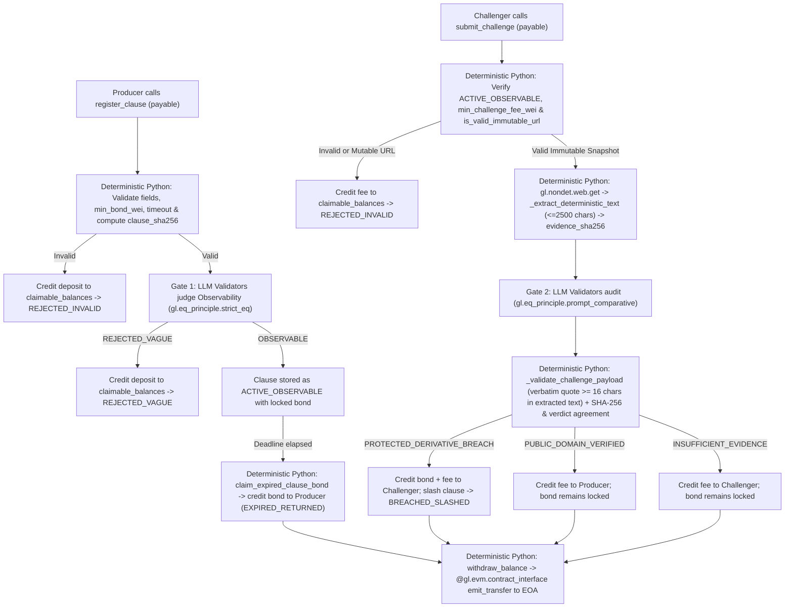

# Public Muse

**Public-Domain Clean-Room Adaptation & Provenance Bonds for Entertainment IP on GenLayer StudioNet**

Public Muse is an on-chain clean-room adaptation registry and provenance bond protocol built on GenLayer StudioNet (`chainId: 61999`). Studios, indie creators, and licensors stake a bond on specific adaptation claims about public-domain works—for example, distinguishing pre-1929 public-domain elements in L. Frank Baum's 1900 novel *The Wonderful Wizard of Oz* (*Silver Shoes*) from later studio-copyrighted additions such as MGM's 1939 film (*Ruby Slippers*).

GenLayer validators evaluate natural-language provenance claims and untrusted archival snapshots using **Optimistic Democracy** (`gl.eq_principle.strict_eq` and `gl.eq_principle.prompt_comparative`), while deterministic Python enforces immutable evidence URLs, bounded text normalization, SHA-256 evidence pinning, fixed payout accounting, timeout fallbacks, and pull-based EOA withdrawals.

---

## Architecture: Deterministic Python vs. LLM Validator Consensus



---

## Live StudioNet Proof & Explorer Links

All contracts and proof transactions are live and finalized (`FINALIZED / MAJORITY_AGREE`) on **GenLayer StudioNet** (`chainId: 61999`, RPC: `https://studio.genlayer.com/api`).

### Deployed Contracts

| Contract | Purpose | StudioNet Address | Explorer |
| --- | --- | --- | --- |
| **PublicMuse** | Main clean-room provenance & bond contract | `0xa528723770aaf22D6e3893D2E8168e48F9217F64` | [View Contract](https://explorer-studio.genlayer.com/address/0xa528723770aaf22D6e3893D2E8168e48F9217F64) |
| **EvidenceProbe** | Live web-fetch & SHA-256 determinism probe | `0xaDDb04fF7a81076eda9D84f1ddEf7aDd74bB6CA9` | [View Contract](https://explorer-studio.genlayer.com/address/0xaDDb04fF7a81076eda9D84f1ddEf7aDd74bB6CA9) |
| **PayableProbe** | Payable deposit & `emit_transfer` EOA probe | `0xa01A982D8e41529251850B65C6deCEfD575D3967` | [View Contract](https://explorer-studio.genlayer.com/address/0xa01A982D8e41529251850B65C6deCEfD575D3967) |

- **PublicMuse Deploy Transaction**: [`0x2c61eb5e0ae1a176a987b87eb8d59d34a391913a8414efe9ed15fabc56bfc678`](https://explorer-studio.genlayer.com/tx/0x2c61eb5e0ae1a176a987b87eb8d59d34a391913a8414efe9ed15fabc56bfc678)

### Finalized On-Chain Proof Cases (`deploy/proof.json`)

| Case | Outcome / Verdict | Key Transaction(s) | Payout / State Summary |
| --- | --- | --- | --- |
| **Case 1**: 1939 MGM *Ruby Slippers* vs 1900 Novel | `PROTECTED_DERIVATIVE_BREACH` | Register: [`0x0d465af8...`](https://explorer-studio.genlayer.com/tx/0x0d465af8c928add02fd6c2e9d9754c609917a5db8d17a7ed64080a788a59766b)<br>Challenge: [`0x43e13080...`](https://explorer-studio.genlayer.com/tx/0x43e13080ebcb0a549fd981a8c20999bec6c4e1bb0bef2aac8ac16c3d795d56b9) | Challenger credited `120 wei` (`100` bond + `20` fee); clause slashed. |
| **Case 2**: 1900 Baum Novel *Silver Shoes* | `PUBLIC_DOMAIN_VERIFIED` | Register: [`0xdd1f620f...`](https://explorer-studio.genlayer.com/tx/0xdd1f620f765b11e9efd5180fb3f4923dc140f7e0b2bf04962cb5fb44013ac9c5)<br>Challenge: [`0x649675ed...`](https://explorer-studio.genlayer.com/tx/0x649675edee463c6e556a48b3e7ce41a6f3c534d9e104061d881917017928c1d8) | Producer retains `100 wei` bond and is credited `20 wei` challenge fee. |
| **Case 3**: Subjective / Vague Claim (Gate 1) | `REJECTED_VAGUE` | Register: [`0x853eed9d...`](https://explorer-studio.genlayer.com/tx/0x853eed9db9c0f3b5195a33d48d5e2255cccd6332d1b5576cc7bc3808bb208248) | `100 wei` deposit safely refunded to producer `claimable_balances`. |
| **Case 4**: Prompt-Injection Resilience (`raw.githubusercontent.com` @ `8812f82f`) | `PUBLIC_DOMAIN_VERIFIED` | Challenge: [`0xfc686466...`](https://explorer-studio.genlayer.com/tx/0xfc686466590bcd1bab82ef3c305fff357316cb5913128f3407f7c51735b9985e) | Producer retains bond and receives `20 wei` challenge fee; embedded injection ignored (`evidence_sha256: 1a4226e2...`). |
| **Case 5**: Unrelated Steam Locomotive Article | `INSUFFICIENT_EVIDENCE` | Challenge: [`0xe4de5d29...`](https://explorer-studio.genlayer.com/tx/0xe4de5d29dd31692aea4e794193ce260c3bf86144529c7628544388d5bc43d03f) | Challenger refunded `20 wei` challenge fee against `clause-2`. |
| **Case 6**: Timeout Fallback & EOA Withdrawal | `EXPIRED_RETURNED` | Register: [`0x86793812...`](https://explorer-studio.genlayer.com/tx/0x867938125f02270e19e3386be8658646238da482b8432d283b2789695c3ba39e)<br>Expire: [`0x40c6bd70...`](https://explorer-studio.genlayer.com/tx/0x40c6bd70e10d25591a502796455ff4a792d7582f3b141c21b50c8494b75e39bc)<br>Producer Withdraw: [`0x6023a08c...`](https://explorer-studio.genlayer.com/tx/0x6023a08c18fe032ac12406d88aa9e5d01942bfe9f17b52afa38120b2a3b5b3d3)<br>Challenger Withdraw: [`0x0b505a99...`](https://explorer-studio.genlayer.com/tx/0x0b505a99017d1b342797a29a11cc6eeaf6073a9525d6db88de673e298334f765) | `15s` clause expired and returned `100 wei`; producer withdrew `220 wei` and challenger withdrew `140 wei` to EOAs. |

---

## Local Setup, Testing & Verification

### 1. Run Contract Unit Tests

```bash
python -m pytest tests/test_public_muse.py -v
```

### 2. Verify Live StudioNet Proofs

Queries StudioNet RPC (`https://studio.genlayer.com/api`) to confirm `chainId === 61999`, all 11 transactions across Cases 1–6 in `deploy/proof.json` are `FINALIZED` with `MAJORITY_AGREE` and `SUCCESS`, and `frontend/` proof mirrors are in sync:

```bash
npm run verify:proof
```

### 3. Build & Run the Frontend

```bash
cd frontend
npm install
npm run build
```

For local development, run `npm run dev` inside `frontend/`. The **Proof Inspector** tab works with zero wallet setup, and the **Live Contract & Wallet Desk** reads live StudioNet state via RPC.

---

## Honest Limitations

1. **Remote Vercel Deployment**: All 6 proof cases (including Case 4 prompt-injection resilience against commit `8812f82f8d492d7f0c7bf406c95147e7e6a17a4a`) are now finalized live on StudioNet, and the repository is hosted at `https://github.com/Kanezar3/Public-Muse`. Remote Vercel frontend deployment (`<PENDING_VERCEL_URL>`) is pending.
2. **Interactive Wallet Signing**: Submitting new clauses, challenges, expiry claims, or withdrawals from the browser UI requires a human signer via MetaMask / EIP-1193 wallet connected to GenLayer StudioNet (`chainId: 61999`).
3. **StudioNet Consensus Latency**: Live write transactions undergo multi-validator Optimistic Democracy consensus and typically take **~30–120+ seconds** per transaction to reach `FINALIZED`.
